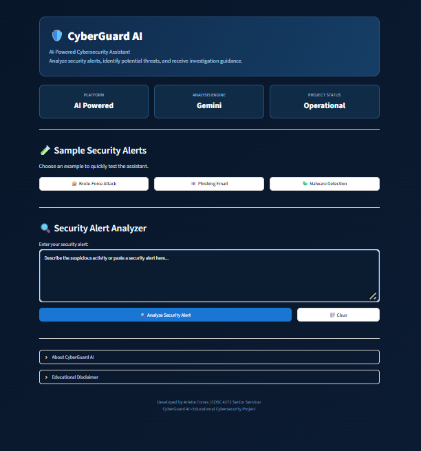
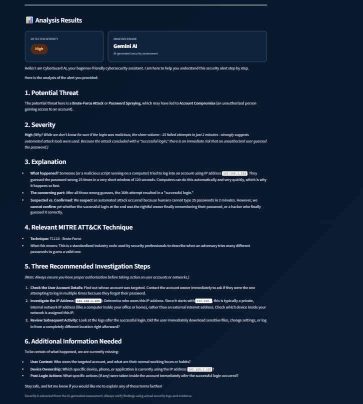
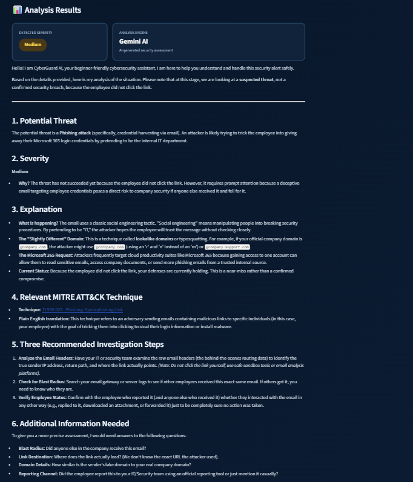

# 🛡️ CyberGuard AI

**AI-Powered Cybersecurity Assistant**

CyberGuard AI is a student-developed cybersecurity application that uses Google's Gemini AI to analyze security alerts, identify potential threats, assess severity, and provide beginner-friendly investigation recommendations.

The project demonstrates how artificial intelligence can support cybersecurity analysis and help users understand suspicious activity.

## Features

- **AI-Powered Alert Analysis:** Uses Google's Gemini API to analyze submitted security alerts.
- **Threat Identification:** Identifies potential cybersecurity threats based on the provided evidence.
- **Severity Assessment:** Categorizes potential threats as Low, Medium, High, or Critical.
- **MITRE ATT&CK References:** Identifies relevant MITRE ATT&CK techniques when applicable.
- **Investigation Recommendations:** Provides suggested investigation steps.
- **Beginner-Friendly Explanations:** Explains security concepts in accessible language.
- **Sample Alerts:** Includes examples of brute-force attacks, phishing emails, and malware detection.
- **Interactive Dashboard:** Provides a custom dark-blue interface built with Streamlit.

## Screenshots

### Dashboard



### Brute-Force Attack Analysis



### Phishing Email Analysis



## Technologies Used

- Python
- Streamlit
- Google Gemini API
- Google GenAI Python SDK
- HTML and CSS (custom interface styling)

## Installation and Setup

### 1. Clone the repository

```bash
git clone https://github.com/ArletteT3/github-portfolio.git
```

### 2. Navigate to the AI assistant folder

```bash
cd github-portfolio/ai-assistant
```

### 3. Install dependencies

```bash
python -m pip install -r requirements.txt
```

### 4. Configure your Gemini API key

Create a Gemini API key through [Google AI Studio](https://aistudio.google.com/).

Set it as an environment variable named `GEMINI_API_KEY`.

**Windows Command Prompt:**

```cmd
setx GEMINI_API_KEY "YOUR_API_KEY"
```

Replace `YOUR_API_KEY` with your actual key. Close and reopen Command Prompt after setting the variable so the new environment variable becomes available.

To verify that the variable is configured without displaying the key, run:

```cmd
if defined GEMINI_API_KEY (echo API key is configured) else (echo API key is missing)
```

Never upload your API key to GitHub or include it in source code.

### 5. Run the application

```bash
python -m streamlit run app.py
```

The application should open in your browser at:

`http://localhost:8501`

## How It Works

1. The user selects a sample security alert or enters their own alert.
2. The application sends the alert to Google's Gemini AI.
3. Gemini analyzes the information and generates a structured response.
4. CyberGuard AI displays the potential threat, severity, explanation, relevant MITRE ATT&CK technique, investigation steps, and additional information needed.

## Application Testing

CyberGuard AI was tested using three sample security scenarios.

| Test scenario | Detected severity | Outcome |
|---|---|---|
| Repeated failed administrator logins followed by a successful login and sensitive file access | High | Identified suspected brute-force activity and possible credential compromise |
| Normal employee login from a familiar company device during business hours | Low | Recognized the activity as normal |
| Suspicious email impersonating the IT department with an unfamiliar password-reset link | Medium | Identified suspected phishing and credential harvesting |

The application generated structured explanations and investigation recommendations for all three tests.

These results demonstrate the application's ability to analyze different security scenarios. AI-generated findings and technique mappings still require human review and verification.

## Project Purpose

This project was developed as part of my COSC 4272 Senior Seminar portfolio at Lamar University.

My goal was to explore the use of generative AI in cybersecurity while strengthening my Python programming, API integration, and application development skills. The project also reflects my interest in pursuing a career as a SOC Analyst.

## Limitations and Disclaimer

CyberGuard AI is an educational prototype. Its AI-generated assessments may be inaccurate, incomplete, or misleading.

The application does not independently access security logs, investigate endpoints, verify incidents, or replace professional security analysts. All findings should be validated using reliable evidence and established incident response procedures.

## Developer

**Arlette Torres**  
Computer Science Student | Aspiring SOC Analyst  
Lamar University

[GitHub Profile](https://github.com/ArletteT3)